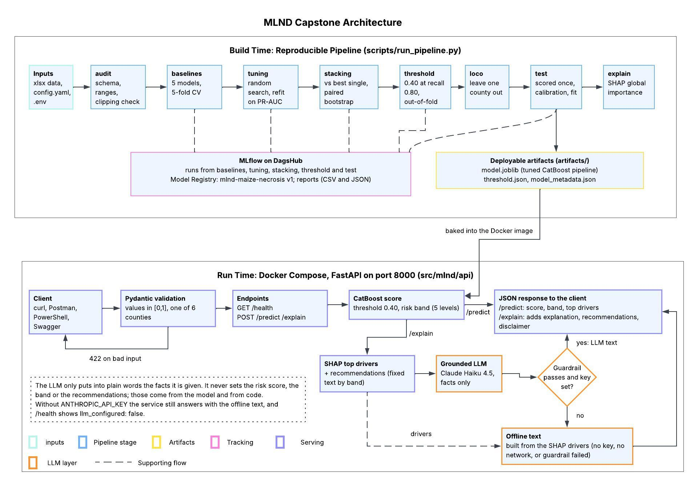
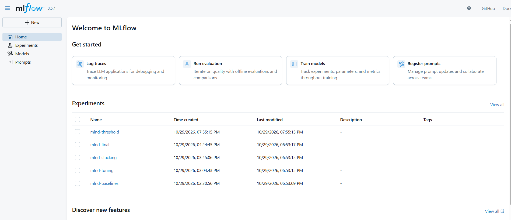
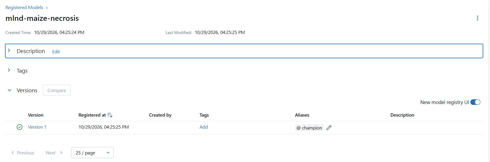
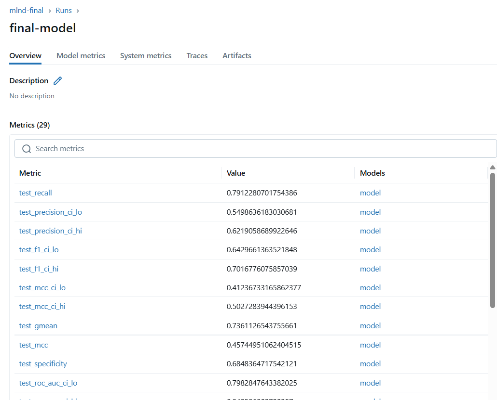

# Maize Lethal Necrosis screening from leaf measurements

DSA 8401 Applied Machine Learning, capstone. Author: Levy Edgar Omoto (224036), MSc Data Science and Analytics, Strathmore University.

A scripted, reproducible machine-learning pipeline that classifies maize leaves for Maize Lethal Necrosis (MLND) based on 11 leaf measurements and a county, and provides a plain-English explanation of each result.

**It is decision support, not a diagnosis.** A flagged leaf needs laboratory confirmation.

## Contents
1. [Overview](#1-overview)
2. [Results at a glance](#2-results-at-a-glance)
3. [Architecture](#3-architecture)
4. [Repository layout](#4-repository-layout)
5. [Setup](#5-setup)
6. [How to reproduce](#6-how-to-reproduce)
7. [Run the service](#7-run-the-service)
8. [Experiment tracking](#8-experiment-tracking)
9. [Method summary](#9-method-summary)
10. [Limitations](#10-limitations)
11. [Data and AI use](#11-data-and-ai-use)

## 1. Overview

| | |
|---|---|
| **Problem** | Flag leaves likely to be infected with MLND so scouts can prioritise lab tests. Missing an infected leaf costs more than a false alarm, so the model is tuned for recall. |
| **Data** | 7,892 leaves, 11 numeric features in [0, 1], 6 Kenyan counties, 36.07% infected (class ratio 1.77 : 1). |
| **Model** | Tuned CatBoost with class weighting, decision threshold 0.40 (chosen for recall of at least 0.80 on out-of-fold predictions). |
| **Output** | A risk score (0 to 1), a flag, a risk band, the top drivers (SHAP), fixed recommendations, and a short explanation written by an LLM that is only allowed to restate the facts it is given. |
| **Stack** | Python 3.12, uv, scikit-learn, imbalanced-learn, CatBoost, SHAP, FastAPI, Docker Compose, MLflow on DagsHub, Claude Haiku 4.5. |

## 2. Results at a glance

Held-out test split (1,579 leaves, 570 infected), scored once at threshold 0.40, with 95% bootstrap intervals. Full details: [reports/test_evaluation.md](reports/test_evaluation.md).

| Metric | Estimate | 95% CI |
|---|---|---|
| Recall | 0.791 | 0.759 to 0.825 |
| Precision | 0.586 | 0.550 to 0.622 |
| F1 | 0.674 | 0.643 to 0.702 |
| MCC | 0.457 | 0.412 to 0.503 |
| G-mean | 0.736 | 0.712 to 0.758 |
| ROC-AUC | 0.819 | 0.798 to 0.843 |
| PR-AUC | 0.740 | 0.705 to 0.777 |

- **Stacking does not beat the single model.** On cross-validated PR-AUC, stacking ties with CatBoost (difference +0.0016, 95% CI -0.0003 to +0.0034), so the simpler single model is deployed. See [reports/stacking_full.md](reports/stacking_full.md).
- **Across counties:** the best-to-worst gap on the test split is 0.055 PR-AUC and 0.113 recall. Leave-one-county-out (train on five, score the sixth) gives recall 0.796 to 0.820. See [reports/loco.md](reports/loco.md).
- **The score is not a probability.** The class-weighted model over-predicts (mean predicted 0.445 against a true rate of 0.361, ECE 0.084, Brier 0.168), so the API calls it a *risk score*.

## 3. Architecture



- **Build time:** `scripts/run_pipeline.py` runs eight stages (audit, baselines, tuning, stacking, threshold, loco, test, explain). Runs are logged to MLflow on DagsHub. The final stage writes `artifacts/model.joblib`, `threshold.json` and `model_metadata.json`.
- **Run time:** the artifacts are baked into a Docker image that serves a FastAPI app. Requests are validated, scored, explained with SHAP, and optionally put into simpler language by the LLM layer. If there is no API key, no network, or the guardrail rejects the text, the service falls back to a text built from the SHAP drivers.

## 4. Repository layout

```
configs/config.yaml     all settings: seed, split, models, thresholds, LLM
data/raw/               source data (MLND data.xlsx)
src/mlnd/
  data.py               loading, validation, audit, clipping check
  features.py           split and leak-free feature engineering
  train.py              baselines: 5 models x imbalance strategies
  tune.py               randomised hyperparameter search
  stack.py              stacking vs single models, paired bootstrap
  threshold.py          threshold chosen on out-of-fold predictions
  evaluate.py           leave-one-county-out, one-time test scoring, registry
  explain.py            SHAP drivers (county columns merged into one)
  llm.py                grounded explanation, guardrail, offline fallback
  api/                  FastAPI app and request/response schemas
scripts/run_pipeline.py one command for the whole pipeline
artifacts/              deployable model, threshold, metadata
reports/                every table and metric the pipeline produces
tests/                  126 pytest tests
Dockerfile, docker-compose.yml
```

## 5. Setup

**Prerequisites:** [uv](https://docs.astral.sh/uv/) and, for the service, Docker Desktop. An Anthropic API key and a DagsHub account are optional.

```bash
git clone <this repository>
cd <repository folder>
uv sync
```

Copy `.env.example` to `.env`.

| Variable | Needed for | Without it |
|---|---|---|
| `MLFLOW_TRACKING_URI`, `MLFLOW_TRACKING_USERNAME`, `MLFLOW_TRACKING_PASSWORD` | Logging runs to DagsHub | Run with `--no-mlflow` |
| `ANTHROPIC_API_KEY` | LLM-written explanations | The API uses the offline explanation |

Check the install:

```bash
uv run pytest -q
```

## 6. How to reproduce

The whole pipeline is one command. Every stage is seeded (seed 42), and rerunning from scratch reproduced identical numbers.

```bash
uv run python scripts/run_pipeline.py --list                # stages and whether their outputs exist
uv run python scripts/run_pipeline.py --quick --no-mlflow   # fast smoke test
uv run python scripts/run_pipeline.py                       # full run, skips finished stages
uv run python scripts/run_pipeline.py --from-scratch        # delete outputs and rerun everything
```

| Option | Effect |
|---|---|
| `--stages audit baselines` | Run only the named stages |
| `--no-mlflow` | Do not log to MLflow (no credentials needed) |
| `--register` | Register the final model in the MLflow Model Registry afterwards |
| `--yes` | Skip the confirmation prompt of `--from-scratch` |

| Stage | What it does | Main outputs |
|---|---|---|
| `audit` | Validates schema, ranges, counties; checks values clipped at 0 and 1 | `reports/data_audit.*` |
| `baselines` | 5 models x 4 imbalance strategies (none, class weights, SMOTE, ADASYN), 5-fold CV | `reports/baselines_full.*` |
| `tuning` | Randomised search, refit on PR-AUC | `reports/best_params_full.json`, `tuning_full.*` |
| `stacking` | Stack vs best single model, per-fold scores, paired bootstrap | `reports/stacking_full.md`, `oof_probabilities_full.csv` |
| `threshold` | Threshold for recall of at least 0.80 on out-of-fold predictions | `artifacts/threshold.json`, `reports/threshold.md` |
| `loco` | Leave-one-county-out on the training split | `reports/loco.*` |
| `test` | One-time test scoring, per-county metrics, calibration, final model fit | `reports/test_*`, `artifacts/model.joblib` |
| `explain` | SHAP global importance and example explanations | `reports/shap_*` |

Notes:
- **The test split is scored once.** `reports/final_evaluation.json` locks it. `--from-scratch` removes the lock deliberately; running `python -m mlnd.evaluate test` by hand needs `--force` to rescore.
- **All fitting happens on the training split.** Feature engineering, scaling and any resampling sit inside one pipeline that is refitted in every fold, so nothing leaks from the validation fold or the test split.

## 7. Run the service

```bash
docker compose up --build -d
```

The first build downloads about 570 MB of Python packages, while later builds reuse the cache. To enable LLM explanations, put `ANTHROPIC_API_KEY` in `.env` first; compose passes only that variable to the container.

The container runs as a non-root user, listens on port 8000, and has a health check. Stop it with `docker compose down`. To run without Docker: `uv run uvicorn mlnd.api.main:app --port 8000`.

| Endpoint | Purpose |
|---|---|
| `GET /health` | Status, model name, threshold, whether the LLM is configured |
| `POST /predict` | Risk score, flag, band and top drivers |
| `POST /explain` | Everything in `/predict` plus explanation, recommendations and a disclaimer |

Inputs are validated: all 11 features must be numbers in [0, 1], `County` must be one of Bungoma, Kakamega, Nakuru, Narok, Trans Nzoia or Uasin Gishu, and unknown fields are rejected with HTTP 422.

**Example (PowerShell):**

```powershell
$body = @{
  County = "Narok"; Chlorosis_Intensity = 0.10; Green_Yellow_Ratio = 0.80
  Necrotic_Area = 0.05; Texture_Roughness = 0.20; Patchiness = 0.10
  Lesion_Distribution = 0.10; Elongated_Streaks = 0.0; Irregular_Lesions = 0.05
  Infected_Distribution = 0.10; Boundary_Sharpness = 0.20; Transition_Smoothness = 0.70
} | ConvertTo-Json
Invoke-RestMethod -Uri http://localhost:8000/explain -Method Post -ContentType "application/json" -Body $body | ConvertTo-Json -Depth 6
```

**Example (bash):**

```bash
curl -s -X POST http://localhost:8000/explain -H "Content-Type: application/json" -d '{
  "County": "Narok", "Chlorosis_Intensity": 0.10, "Green_Yellow_Ratio": 0.80,
  "Necrotic_Area": 0.05, "Texture_Roughness": 0.20, "Patchiness": 0.10,
  "Lesion_Distribution": 0.10, "Elongated_Streaks": 0.0, "Irregular_Lesions": 0.05,
  "Infected_Distribution": 0.10, "Boundary_Sharpness": 0.20, "Transition_Smoothness": 0.70}'
```

**Response (shortened):**

```json
{
  "label": "not_flagged",
  "risk_score": 0.0209,
  "threshold": 0.4,
  "flagged": false,
  "band": "clear",
  "drivers": [
    {"feature": "Elongated_Streaks", "label": "Streak-shaped marks", "value": 0.0,
     "contribution": -0.6157, "direction": "lowers risk"}
  ],
  "explanation": {"text": "The risk score is 0.02, which is well below ...", "source": "llm", "reason": null},
  "recommendations": ["No action is needed from this reading alone; keep up routine scouting.",
                      "Re-check the plant if symptoms change or spread."],
  "disclaimer": "Decision support only. A laboratory test is needed to confirm MLND."
}
```

**Risk bands:**

| Band | Risk score |
|---|---|
| clear | below 0.25 |
| near_threshold | 0.25 to 0.40 |
| just_flagged | 0.40 to 0.55 |
| flagged | 0.55 to 0.75 |
| high_risk | 0.75 and above |

**How the explanation stays honest.** The score, band, drivers and recommendations come from the model and from code. The LLM only rewrites a fixed set of facts. A guardrail rejects text that uses forbidden terms, quotes a percentage or "probability", or contains numbers not in the facts. In those cases, or with no key or network, the service returns the offline text (`"source": "offline"`).

## 8. Experiment tracking

Runs are logged to MLflow hosted on DagsHub. The five experiments below are the ones the pipeline creates:



| Experiment | Contents |
|---|---|
| `mlnd-baselines` | Baseline models and imbalance strategies |
| `mlnd-tuning` | Search results per model |
| `mlnd-stacking` | Stack vs single-model comparison |
| `mlnd-threshold` | Threshold choice and operating points |
| `mlnd-final` | Final test metrics |

The deployed model is registered as `mlnd-maize-necrosis` (version 1) in the MLflow Model Registry, with its metrics.





## 9. Method summary

- **Models compared:** logistic regression, random forest, XGBoost, LightGBM and CatBoost, each with four imbalance options (none, class weights, SMOTE, ADASYN). Class weighting was chosen for tuning, and CatBoost led on PR-AUC.
- **Tuning:** randomised search with 5-fold CV, refit on PR-AUC. Best CatBoost: depth 6, 585 iterations, learning rate 0.0173, L2 regularisation 7.
- **Stacking:** random forest, XGBoost, LightGBM and CatBoost with a logistic-regression meta-learner, compared with nested CV and a paired bootstrap. It ties with CatBoost, so it is not deployed.
- **Threshold:** 0.40, the point where out-of-fold recall reaches 0.80 (0.806; bootstrap interval 0.38 to 0.42). On the test split recall is 0.791, slightly under the target, because the final model is trained on all training rows.
- **Explainability:** SHAP on the tree model. The six county columns and the county-mean feature are merged into one "County" driver. Contributions are in log-odds and add up to the score.
- **Left out on purpose**: TabNet and deep learning, because the signal is weak and simple, so boosted trees are enough and deep models would be slower on a CPU; stacking, because it tied with the single model; unsupervised methods, because the data has labels; and fine-tuned or retrieval-based LLMs, because the explanation only needs to restate facts the model already gives.

## 10. Limitations

- **Modest signal.** ROC-AUC is about 0.82 and precision at the chosen threshold is 0.59, so about four in ten flagged leaves are not infected. That is acceptable for screening but not for a diagnosis.
- **Calibration.** The score over-predicts at every level (ECE 0.084), so it should be read as a ranking, not a probability.
- **Data quality.** Values pile up at exactly 0 and 1 (6 to 11 times the neighbouring range, in all 11 features), which suggests clipping or a measurement artefact. The data may also have been processed before release, so these results do not prove how the model would perform in the field.
- **Location is county only.** There is no weather, variety or planting-date information, and a county not in the training set is rejected.
- **Leave-one-county-out scores may be a little too good.** The settings and the threshold were chosen using all six counties, so a truly new county could score slightly lower.
- **The LLM text is paraphrase only.** The guardrail reduces, but cannot eliminate, wording slips. It never changes the score, band or recommendations.

## 11. Data and AI use

- **Data:** Wanyonyi, M. (2026). Real world dataset for maize lethal necrosis disease classification in Kenya incorporating visual, texture, and spatial features under class imbalance. Zenodo (CERN European Organization for Nuclear Research). https://doi.org/10.5281/zenodo.19997730
- **AI use:** see [AI_USE.md](AI_USE.md).
